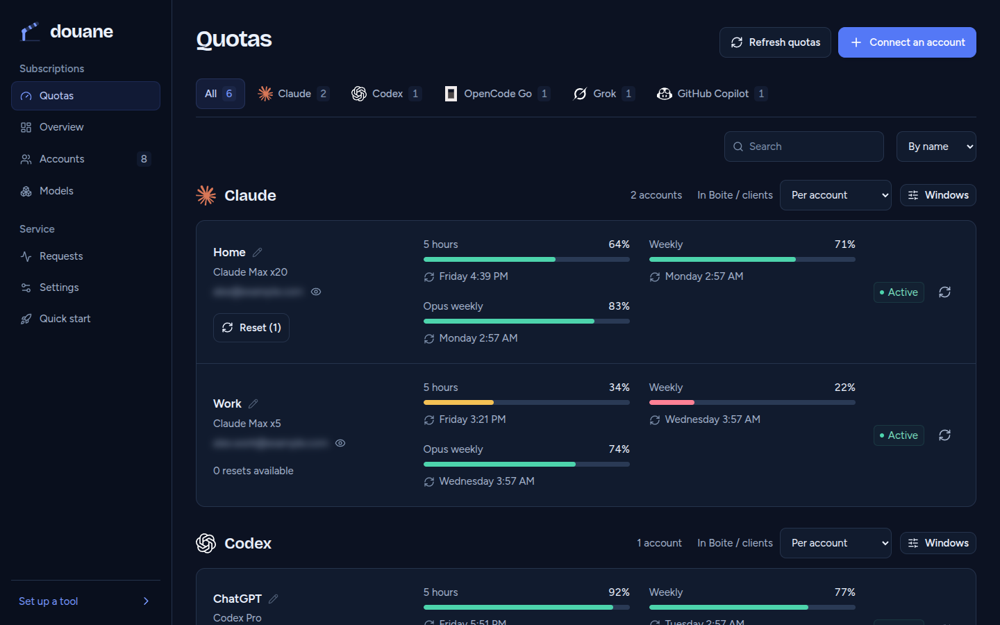
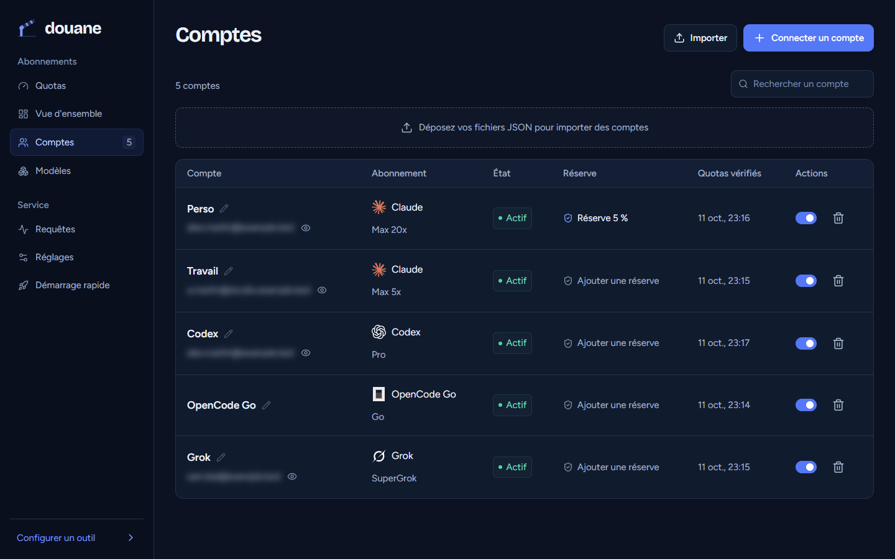
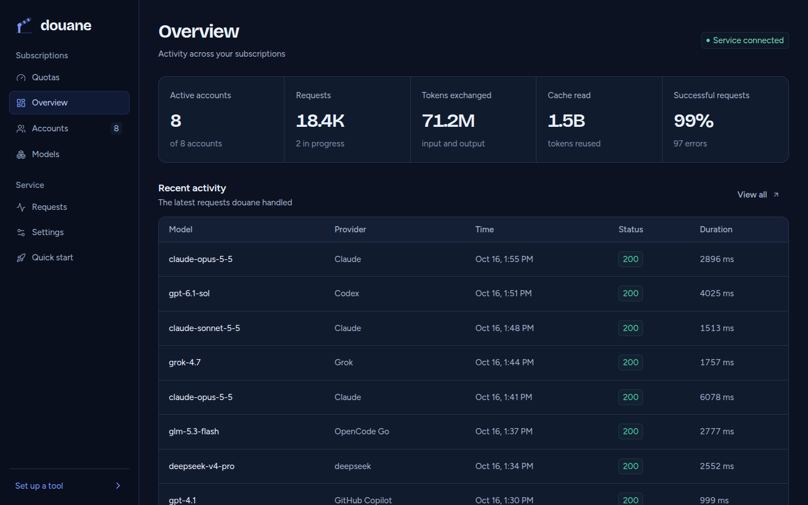

# douane

[](https://github.com/beboite/douane/actions/workflows/ci.yml)
[](LICENSE)


One self-hosted endpoint for every AI subscription you pay for.

douane connects your Claude, ChatGPT (Codex), Antigravity, Grok and OpenCode Go subscriptions, then serves them to any coding tool through OpenAI- and Anthropic-compatible APIs. It watches each account's quota, picks the account that should serve the next conversation, and keeps a conversation on the same account so the provider's prompt cache stays warm. A single Rust binary with an embedded dashboard; no Node.js, Docker or external database at runtime.



## Features

- One base URL and one placeholder key for Claude Code, the Grok CLI, Boite and any OpenAI-compatible client.
- Chat Completions, Anthropic Messages and Responses, streaming included, with translation between them; native Codex WebSocket sessions.
- Live quotas per account: five-hour, daily, weekly and monthly windows, reset times, plan tier, extra credits and banked resets, refreshed in the background.
- Four routing strategies, per provider if you like, and failover to another account of the same provider when one runs out.
- Conversation affinity: native session ids and `prompt_cache_key` pin a conversation to its account, so cache reads keep landing.
- Per-account reserve: stop spending an account at 5 % of its weekly quota (or any share) so you keep some for yourself.
- Request history with latency, token and cache counters; never conversation bodies or credentials.
- OAuth and device sign-in from the dashboard, JSON import of existing CLI credentials, and `douanectl` for scripting.

## Providers

| Provider | Connect with | Quotas |
| --- | --- | --- |
| Claude (Pro, Max) | OAuth in the dashboard, or credential import | Five-hour, weekly and weekly Opus windows, extra usage, banked resets |
| Codex (ChatGPT plans) | OAuth in the dashboard, or credential import | Five-hour and weekly windows, credits, banked resets |
| Antigravity | Google OAuth once a client is configured, or import | Per-model quotas |
| Grok (SuperGrok) | Device code in the dashboard | Weekly or monthly credit windows |
| OpenCode Go | Subscription key in the manual form | Five-hour, weekly and monthly windows |
| Gemini CLI, Kimi | Credential import | Read from the provider |
| Qwen, OpenAI-compatible upstreams | Credential import | Not reported |

What a provider exposes depends on the account and plan. A quota douane cannot read stays unknown; it is never estimated.

## Quick start

### Docker

Images for `linux/amd64` and `linux/arm64` are on GitHub Container Registry: `latest` is the last release, `edge` follows `main`.

```sh
docker compose up -d   # with compose.yaml from this repository
```

or without compose:

```sh
docker run -d --name douane --restart unless-stopped \
  -p 127.0.0.1:8787:8787 -v douane:/data ghcr.io/beboite/douane:latest
```

Accounts, the database and `douane.toml` live in the `/data` volume; put a configuration file there to change settings. The container runs as uid 65532, so a bind-mounted folder must be writable by that uid. `docker exec douane douanectl status` runs the CLI inside it. The port is published on loopback only: read [Security and data](#security-and-data) before exposing it.

### From source

Build with Rust 1.90 or newer. SQLite is bundled and the dashboard is already compiled into the repository.

```sh
cargo build --workspace --release --locked
```

`target/release` now holds `douane` and the management CLI `douanectl`. Both are self-contained and can be copied to another machine with the same OS and architecture.

Start the service. Without a configuration file it listens on `127.0.0.1:8787` and keeps `auth/` and `douane.sqlite` in the working directory. With one, relative paths resolve from the file's folder, and settings changed in the dashboard are saved back to it. [`douane.example.toml`](douane.example.toml) lists every setting.

```sh
douane --config douane.toml --check   # validate, create nothing
douane --config douane.toml
```

Open `http://127.0.0.1:8787/admin`, choose **Connecter un compte** (connect an account) and sign in to a provider. When douane runs on another machine, paste the callback URL or code shown by the provider back into the dialog: the provider's localhost redirect does not need to reach the server.

Then point a client at it:

```sh
curl http://127.0.0.1:8787/v1/models

curl http://127.0.0.1:8787/v1/chat/completions \
  -H 'Authorization: Bearer douane' \
  -H 'Content-Type: application/json' \
  -d '{"model":"<id from /v1/models>","messages":[{"role":"user","content":"Hello"}],"stream":true}'
```

Model ids carry their provider prefix, for example `claude/...` or `codex/...`. The key `douane` is a placeholder: authentication upstream uses the connected subscription.



## Clients

The dashboard's **Configurer un outil** page writes these settings for you, with your own address.

| Client | Settings |
| --- | --- |
| OpenAI-compatible tools | Base URL `http://127.0.0.1:8787/v1`, API key `douane`, a model id from `/v1/models` |
| Claude Code | `ANTHROPIC_BASE_URL=http://127.0.0.1:8787` (no `/v1`), `ANTHROPIC_AUTH_TOKEN=douane` |
| Grok CLI | `XAI_API_KEY=douane`, `GROK_MODELS_BASE_URL` and `GROK_XAI_API_BASE_URL` set to `http://127.0.0.1:8787/v1`, `GROK_MODELS_LIST_URL=http://127.0.0.1:8787/v1/models?provider=xai&ids=upstream` |
| [Boite](https://github.com/beboite/boite) | Subscription proxy set to the dashboard URL: Boite lists the models and draws each account's quota bars from `/v1/quotas` |

For the Grok CLI, a session saved by `grok login` takes precedence over the key; set `GROK_AUTH_PATH` to a missing file to keep it out.

If clients reach the API at a different address than the dashboard (a reverse proxy, a separate host name), set `server.client_api_base_url` so the generated snippets use it.

## API

| Endpoint | Purpose |
| --- | --- |
| `GET /health` | Service health |
| `GET /v1/models` | Available models; `?provider=xai,claude` filters, `&ids=upstream` lists provider-native ids in the provider's order |
| `GET /v1/quotas` | Quotas per provider, per account or averaged, for client status bars |
| `POST /v1/chat/completions` | Chat Completions, streaming included |
| `POST /v1/messages` | Anthropic Messages, streaming included |
| `POST /v1/messages/count_tokens` | Claude token counting, relayed to the provider |
| `POST /v1/responses` | Responses, streaming included |
| `POST /v1/responses/compact` | Native compaction on compatible upstreams |
| `GET /v1/responses` (WebSocket) | Native Codex sessions, and a streaming bridge for the other subscriptions |
| `/admin/api/*` | Accounts, quotas, models, request history, settings and OAuth |
| `/v0/management`, `/v8/management` | A CLIProxyAPI-compatible subset of its management API |

Translation between the three dialects covers text, tools and images; provider-specific extensions do not all have an equivalent. A failed request moves to another account only before its first byte reaches the client: started output is never replayed. A same-dialect request returns the provider's own rate-limit headers and request id, and client errors such as an oversized prompt come back as the provider wrote them.

## Routing and quotas

Pick a strategy in **Réglages** (settings), globally or per provider. It applies to new conversations:

| Strategy | Behaviour |
| --- | --- |
| `smart` (default) | Sends 90 % of new conversations to the account whose weekly reset comes within 48 hours, until it is exhausted; otherwise weighs remaining quota against time left, with 20 % plain rotation |
| `reset-first` | Uses the account with the nearest weekly reset, and moves running conversations back to it as soon as it is eligible again |
| `fill-first` | Uses the first eligible account until it becomes unavailable |
| `round-robin` | Rotates through eligible accounts |

A conversation stays on its account while that account is eligible. douane recognises Codex, Claude and OpenCode session ids, `session_id` headers and `prompt_cache_key`, and keeps Claude cache controls untouched. A custom client should send one stable id per conversation. The affinity table holds 10,000 conversations for 24 hours of inactivity, in memory.

When an account is refused, it rests until the provider's own reset (its `retry-after`, Claude's rejected window, Codex's exhausted window), then returns. Accounts whose subscription quota is gone but which still hold usable credits stay available behind accounts with quota left.

A reserve, set per account on the Accounts page or with `PATCH /admin/api/accounts/{id}` and `{"reserve_percent": 5}`, is a hard floor on the weekly window: once it reaches the floor, douane stops using that account, live conversations included, until the weekly reset. Five-hour, daily and monthly windows never trip it. Close to the floor, quotas are reread at most once a minute, so a burst can overshoot by a little.

Banked resets for Claude and Codex appear on each account card. Using one asks for confirmation, and a retried click reuses the same request id, so a double click cannot spend two.



## Security and data

- Credentials stay in `auth_dir` as local files. They never appear in the dashboard, the management API, logs or errors, and refresh-token rotation is serialised and written to disk.
- SQLite stores request metadata only: time, model, account, status, latency and token or cache counts.
- The default listener is loopback. To expose douane, put it behind a reverse proxy that authenticates the dashboard, and set `server.management_token_env` to require a bearer token on `/admin/api`. That token is separate from client access.
- Google OAuth clients for Gemini and Antigravity are read from `oauth-clients.json` beside `auth_dir`, or from `DOUANE_GEMINI_*` and `DOUANE_ANTIGRAVITY_*` environment variables; douane ships none.

## Command line

```sh
douanectl health
douanectl status
douanectl accounts
douanectl quotas --refresh
douanectl models
douanectl import account.json --name "Work"
douanectl login codex
douanectl complete <oauth-session-id> --callback-file callback.txt
douanectl disable <account-id>
douanectl enable <account-id>
douanectl remove <account-id>
```

`--url` targets another instance and `DOUANE_MANAGEMENT_TOKEN` supplies the management token. Secrets are read from files, never from arguments.

## Development

```sh
cargo test --workspace --all-targets --locked
```

The dashboard is Svelte 5 in [`dash/`](dash). Changing it needs Node.js 24 and pnpm 11:

```sh
cd dash
pnpm install --frozen-lockfile
pnpm check
pnpm build
```

Commit `dash/build` with the source change, then rebuild Rust to embed it. `pnpm dev` runs the dashboard alone and expects the management API at the same origin or behind a proxy for `/admin/api`.

CI tests Rust on the minimum supported version, checks and builds the dashboard, and builds the Docker image on amd64 and arm64, then runs [`docker/smoke.sh`](docker/smoke.sh) against it; a pull request runs only the jobs its files touch. Tests run against local fake upstreams; they do not prove that a real provider accepts a given account or model.

A release is a tag `vX.Y.Z` equal to the version in `Cargo.toml`: CI runs again, the tested image is published as `X.Y.Z`, `X.Y` and `latest`, and the GitHub release is created.

## Disclaimer

douane is an independent project, not affiliated with Anthropic, OpenAI, Google, xAI or any other provider. Use it with accounts you own and within each provider's terms.

## License

[AGPL-3.0-or-later](LICENSE). The model catalogue in `crates/douane/data` is derived from CLIProxyAPI under the MIT license; see [NOTICE](crates/douane/data/NOTICE).
